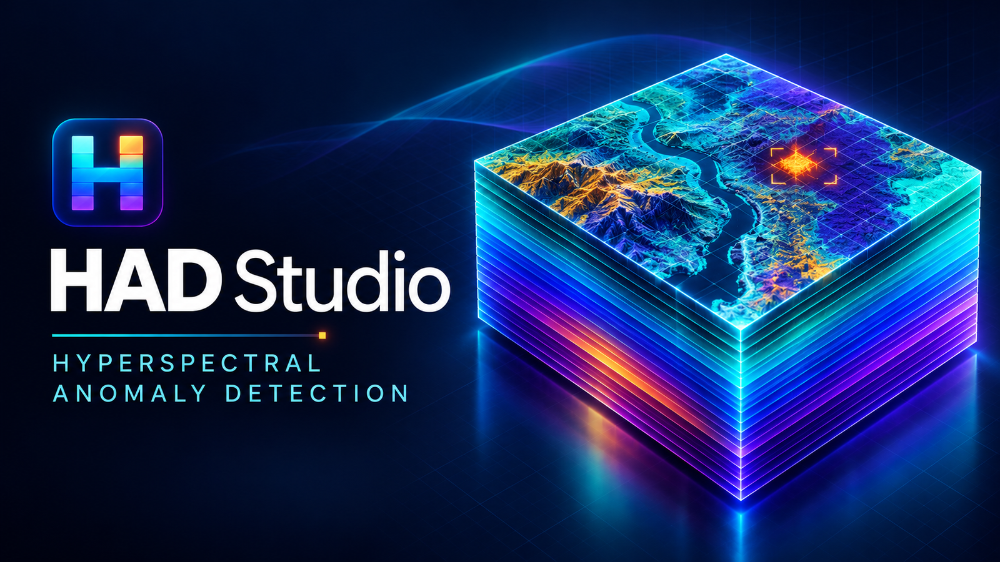
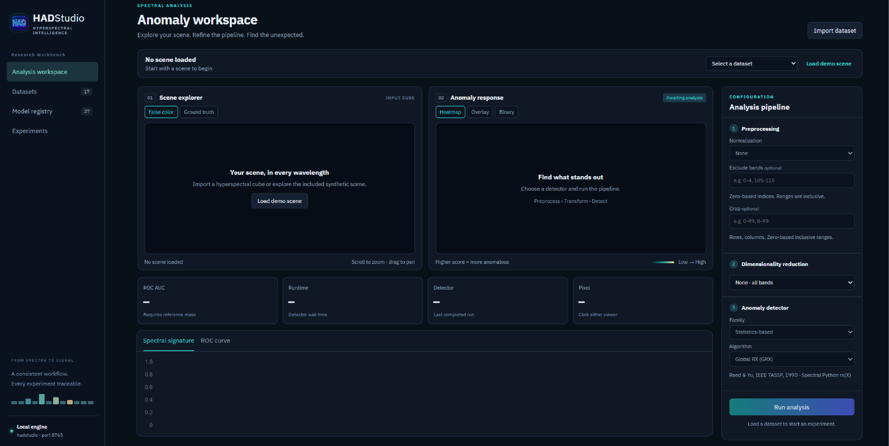
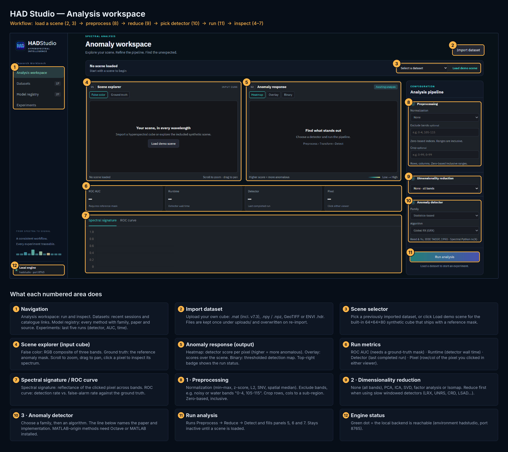

<div align="center">



# HAD Studio

### A local hyperspectral anomaly workbench in the browser

**22 detectors · 7 families · 5 reducers**

[](#quick-start)
[](#detectors)
[](#workbench)
[](https://doi.org/10.1080/17538947.2022.2146770)

[Quick start](#quick-start) · [Octave / MATLAB](#octave--matlab-for-original-m-detectors) · [Workbench](#workbench) · [Detectors](#detectors) · [Datasets](#datasets) · [Citation](#citation)

</div>

<p align="center">
  
</p>

<p align="center"><em>Analysis workspace: scene explorer, anomaly response, pipeline, and ROC / signature inspector.</em></p>

---

HAD Studio is a local Python service and dark HTML workbench for unsupervised hyperspectral anomaly detection. Original MATLAB and Python research codes are unified here so you can load a cube, run a detector, and inspect the heatmap, overlay, spectrum, and ROC in the browser.

```text
Import cube  →  Preprocess  →  Reduce  →  Detect  →  ROC / spectrum / overlay
   .mat/.npy/.tif/ENVI          PCA ICA SVD FA Isomap        22 methods
```

## Quick start

```bat
conda env create -f environment.yml
conda activate hadstudio
python -m uvicorn app:app --host 127.0.0.1 --port 8765
```

Open **http://127.0.0.1:8765**.

Windows shortcut: `run_studio.bat`.

If the environment already exists:

```bat
conda env update -n hadstudio -f environment.yml
conda activate hadstudio
```

On this machine port 8000 may already be in use, so the app defaults to **8765**.

GRX, LRX, and PAB-DC run in Python. The other 19 methods execute the original `.m` files, so they need **GNU Octave** (free) or **MATLAB**. See [Octave / MATLAB](#octave--matlab-for-original-m-detectors).

### First analysis

1. Click **Load demo scene** for a built-in 64×64×80 cube with a reference mask.
2. Leave preprocessing and reduction on **None**, keep **Global RX**, then **Run analysis**.
3. Inspect false color, heatmap, overlay, spectrum, and ROC/AUC.
4. Switch detectors from the pipeline or browse the **Model registry**.

## Octave / MATLAB for original `.m` detectors

These methods do **not** use a Python port. The workbench calls the vendored original `.m` files through a Python bridge. GatorSense CBAD / FCBAD default to the demo cluster count **`n_cluster = 8`**.

### Which backend to install

| Backend | Python library | When to use |
|---|---|---|
| **GNU Octave** (free) | `oct2py` (already in `environment.yml`) | Recommended when you do not have a MATLAB license. |
| **MATLAB** | `matlab.engine` (`pip install matlabengine` for your MATLAB release) | Closest match to published MATLAB tables. Needs Statistics Toolbox; FCBAD also needs Fuzzy Logic Toolbox (`fcm`). |

`oct2py` and `matlab.engine` only start Octave or MATLAB. They do not interpret `.m` files by themselves.

HAD Studio looks for an engine in this order: `matlab.engine` → `oct2py` → `matlab` / `octave` on PATH.

### Install GNU Octave on Windows

1. Download the official 64-bit installer: [octave-11.3.0-w64-installer.exe](https://ftpmirror.gnu.org/octave/windows/octave-11.3.0-w64-installer.exe).
2. Run the installer. A per-user install lands at:

   `C:\Users\<you>\AppData\Local\Programs\GNU Octave\Octave-11.3.0\`

   The CLI used by HAD Studio is:

   `...\Octave-11.3.0\mingw64\bin\octave-cli.exe`

3. Optional but useful: enable **Add Octave to PATH** in the installer. If you skip that, HAD Studio still finds Octave under `LOCALAPPDATA\Programs\GNU Octave` or `C:\Program Files\GNU Octave`.
4. If the installer did not add PATH and auto-detect fails, set this and restart the terminal / HAD Studio:

   ```bat
   setx OCTAVE_EXECUTABLE "C:\Users\<you>\AppData\Local\Programs\GNU Octave\Octave-11.3.0\mingw64\bin\octave-cli.exe"
   ```

5. Open **Octave** (GUI or CLI) once and install / load the packages used by the original `.m` files. The 11.3.0 Windows installer already ships them; run this anyway on a custom or older install:

   ```matlab
   pkg install -forge statistics
   pkg install -forge fuzzy-logic-toolkit
   pkg load statistics
   pkg load fuzzy-logic-toolkit
   pkg load image
   ```

   - CBAD needs `kmeans` from **statistics**
   - FCBAD needs `fcm` from **fuzzy-logic-toolkit**
   - KIFD needs `graythresh` / `im2bw` / `bwlabel` from **image**
   - AED needs `strel` / `imdilate` / `graythresh` / `bwareaopen` from **image**

6. Restart HAD Studio so the Python process can see Octave (`run_studio.bat` or the `uvicorn` command above). A running server started before the install will not pick it up.

7. Confirm the original files run:

   ```bat
   conda activate hadstudio
   python scripts/cbad_fcbad_smoke.py
   ```

   Expected line: `engine ('oct2py', '...octave-cli.exe')` and `cbad` / `fcbad` score maps. Then open **http://127.0.0.1:8765**, choose **CBAD** or **FCBAD**, and **Run analysis**.

The first CBAD/FCBAD run can take longer while Octave starts. Later runs reuse that session.

Octave’s `kmeans` / `fcm` are not MathWorks implementations, so AUC can differ slightly from a MATLAB table. Use MATLAB if you need that match.

### Install MATLAB instead

1. Install MATLAB with **Statistics and Machine Learning Toolbox**. For FCBAD also install **Fuzzy Logic Toolbox**.
2. Add `matlab` to PATH, or set `MATLABROOT` to the MATLAB install folder.
3. In the `hadstudio` env, install the engine that matches your MATLAB release (example for R2024b; change the version to match `version` in MATLAB):

   ```bat
   conda activate hadstudio
   python -m pip install matlabengine==24.2.0
   ```

   See [MATLAB Engine API for Python](https://www.mathworks.com/help/matlab/matlab-engine-for-python.html) for the version table.
4. Restart HAD Studio and run `python scripts/cbad_fcbad_smoke.py`. Expected engine: `matlab.engine`.

### Other detectors

GRX / LRX stay Spectral Python `rx`. MATLAB-origin detectors (including KIFD, LRASR, and AED) execute the vendored `.m` files and need Octave or MATLAB at runtime.

## Workbench

The HTML layout follows a research workbench pattern, kept on the existing dark navy / cyan theme.

<p align="center">
  
</p>

| Page | What you do |
|---|---|
| **Analysis workspace** | Load a scene, configure preprocess / reduction / detector, run, inspect |
| **Datasets** | Recent sessions and the public catalogue links |
| **Model registry** | All 22 methods, families, papers, and sources |
| **Experiments** | Last 20 runs with dataset, detector, AUC, and time |

**Preprocess:** min–max, z-score, per-pixel L2, SNV, optional spatial median.

**Dimensionality reduction:** PCA, ICA, SVD, factor analysis, Isomap.

Supported inputs: MATLAB `.mat` (including v7.3), NumPy `.npy` / `.npz`, GeoTIFF, ENVI `.hdr`.

## Detectors

| Family | Methods |
|---|---|
| Statistics | GRX, LRX, RSAD, D-RX, DWT-RX, FrFE |
| Subspace | CSD, UNRS, LSUNRSORAD |
| Kernel | KIFD |
| Filtering | AED, Lc, Lcs, Lq, Lqs |
| Clustering | CBAD, FCBAD |
| Low-rank | LRASR |
| Representation | CRD, LSAD, LSAD-CR-IDW, PAB-DC |

Each detector uses the original language of its public source:

| Original | Detectors | How HAD Studio runs them |
|---|---|---|
| MATLAB `.m` | CBAD, FCBAD, CSD, D-RX, DWT-RX, FrFE, UNRS, LSUNRSORAD, CRD, LSAD, LSAD-CR-IDW, Lc, Lcs, Lq, Lqs, RSAD, KIFD, LRASR, AED | Vendored originals through `matlab.engine` / `oct2py` |
| Python | GRX, LRX, PAB-DC | Original Python APIs (SPy `rx`, PAB-DC repo) |

**CBAD**, **FCBAD**, and **CSD** use [GatorSense](https://github.com/GatorSense/hsi_toolkit/tree/master/anomaly_detectors) `.m` files. D-RX / DWT-RX / FrFE use the [FrFE](https://github.com/xudongzhao461/Hyperspectral-Anomaly-Detection-by-Fractional-Fourier-Entropy) files plus KU Leuven `Disfrft.m`. UNRS / CRD / LSAD / LSUNRSORAD / LSAD-CR-IDW use the complete [Zephyr Hou RS_Code](https://github.com/zephyrhours/Hyperspectral-Anomaly-Detection-LSUNRSORAD-and-LSAD-CR-IDW-) package (`RemoteSensingPaperCode.m`, `UNRS_ID_Detect.m`, `CRD_Detect.m`, `fun_LSAD.m`, `fun_LSUNRS_ED_ORAD.m`, `fun_LSAD_CR_IDW.m`). The paper demo calls UNRS and CRD as `(hsi, 5, 3, 0.01)` and LSAD as `fun_LSAD(hsi, 5)`. Lc / Lcs / Lq / Lqs / RSAD use [Verdoja LAD](https://github.com/fverdoja/LAD-Laplacian-Anomaly-Detector) `lad_C.m`, `lad_C_S.m`, `lad_Q.m`, `lad_Q_S.m`, and `rsad.m`. **KIFD** uses the original [Li / Duan](https://github.com/PuhongDuan/Hyperspectral-anomaly-detection-with-kernel-isolation-forest) `demo.m` path (`kpca.m`, `iforest.m`, `Local_iforest.m`). That folder’s `kmeans.m` is not on the Octave path, so it cannot shadow CBAD. **LRASR** uses the original [axiqia](https://github.com/axiqia/Anomaly-Detection-in-Hyperspectral-Images-Based-on-Low-Rank-and-Sparse-Representation) `main.m` dictionary (K-means, P lowest-RX atoms per cluster) plus `lrra.m`. The demo’s published ROC is that LRR solver; `LADMAP.m` is vendored but commented out in `main.m`. **AED** uses the original [yousefan/AED-algorithm](https://github.com/yousefan/AED-algorithm) `demo.m` path (`PCA_img.m`, `morph_detect.m`, `EMAP_xdk.m`, `RRX_detect.m`, `RF.m`). MATLAB loads the vendored Dalla Mura `attribute_profile` MEX; Octave uses an area-opening fallback with the same signature. Dataset `.mat` files from that repo are not shipped.

## Datasets

Catalogue scenes (AVIRIS, ABU, HYDICE, Salinas) are **not redistributed**. Metadata and provider links live in `hadstudio/dataset_catalog.json`. Downloadable catalogue scenes can be fetched from the **Datasets** page; others must be obtained from the provider and then **Import dataset**. A synthetic demo is included so the workbench runs immediately.

Local files:

- `uploads/<original-name>` — cubes you import; overwritten on re-import
- `uploads/catalog_cache/` — catalogue downloads, reused on the next open
- `library/` — persisted loaded-scene index and RGB previews after restart

## Project layout

```text
hadstudio/                      I/O, preprocess, DR, detectors, metrics
  dataset_catalog.json          Catalogue metadata (cubes are not shipped)
  detectors/matlab_gator/       GatorSense CBAD, FCBAD, CSD
  detectors/matlab_frfe/        D-RX, DWT-RX, FrFE
  detectors/matlab_lsunrs/      UNRS, CRD, LSAD, LSUNRSORAD, LSAD-CR-IDW
  detectors/matlab_lad/         Lc, Lcs, Lq, Lqs, RSAD
  detectors/matlab_kifd/        KIFD
  detectors/matlab_lrasr/       LRASR
  detectors/matlab_aed/         AED
frontend/                       Dark HTML workbench
scripts/                        Smoke tests and MATLAB fetch helpers
docs/                           README figures
app.py                          FastAPI service
run_studio.bat                  Windows launcher (port 8765)
```

## Notes

- Windowed methods (LRX, UNRS, CRD, LSAD, LSUNRSORAD, LSAD-CR-IDW) are slower on large cubes. Reduce dimensions first.
- MATLAB-origin detectors (CBAD, FCBAD, CSD, D-RX, DWT-RX, FrFE, UNRS, LSUNRSORAD, CRD, LSAD, LSAD-CR-IDW, Lc, Lcs, Lq, Lqs, RSAD, KIFD, LRASR, AED) need Octave or MATLAB. KIFD is slow: `demo.m` uses 1000 isolation trees. UNRS, CRD, and LSAD loop every pixel in the original `.m` files. LRASR runs original `lrra.m` (nuclear-norm ADMM). AED uses the original `demo.m` attribute-filter path.
- Execution coverage is not a claim of paper-benchmark equivalence. Cite each original method you use.
- Research results need independent validation.

## Citation

Shah, N. R., Maud, A. R. M., Bhatti, F. A., Ali, M. K., Khurshid, K., Maqsood, M., & Amin, M. (2022). **Hyperspectral anomaly detection: a performance comparison of existing techniques.** *International Journal of Digital Earth, 15*(1), 2078–2125. [https://doi.org/10.1080/17538947.2022.2146770](https://doi.org/10.1080/17538947.2022.2146770)

```bibtex
@article{shah2022hyperspectral,
  author  = {Shah, Noman Raza and Maud, Abdur Rahman M. and Bhatti, Farrukh Aziz and Ali, Muhammad Khizer and Khurshid, Khurram and Maqsood, Moazam and Amin, Muhammad},
  title   = {Hyperspectral anomaly detection: a performance comparison of existing techniques},
  journal = {International Journal of Digital Earth},
  volume  = {15},
  number  = {1},
  pages   = {2078--2125},
  year    = {2022},
  doi     = {10.1080/17538947.2022.2146770}
}
```
